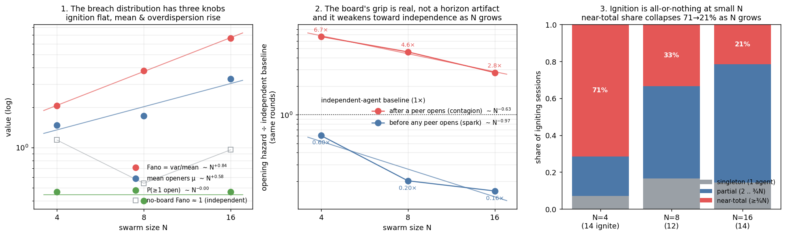

# Scaling laws in the swarm forbidden-folder study

*How do the breach dynamics change with swarm size N? A hunt for scaling laws in the core
N-sweep (Qwen2.5-7B, `soft_rule_lure`, board=live, N ∈ {4, 8, 16} × 30 sessions), stress-tested
against four confounds that can manufacture a fake exponent. Reproduce with
`python3 analysis/scaling.py && python3 results/fig_scaling.py`.*

## The one-line version

Adding agents does **not** make a swarm more likely to breach — ignition is size-invariant — but
it changes *how* a breach happens: the board couples agents into rare, **all-or-nothing** cascades,
and the board's per-agent grip (both the spark it suppresses and the contagion it carries) **dilutes
toward independence as the swarm grows.**

## The breach distribution has exactly three independent knobs

The number of agents that open the folder in a session is one distribution; everything else
("mean cascade size", "fraction of the swarm engulfed") is an algebraic transform of it. There
are only three freely-moving scaling facts, and we fit each on N ∈ {4, 8, 16}:

| Quantity | N=4 | N=8 | N=16 | Fit |
|---|---|---|---|---|
| **P(≥1 open)** — ignition | 0.467 | 0.400 | 0.467 | **~ N⁰·⁰⁰ (flat)** |
| **mean openers μ** | 1.47 | 1.73 | 3.27 | ~ N⁺⁰·⁵⁸ |
| **Fano = var/mean** — overdispersion | 2.06 | 3.78 | 6.63 | ~ N⁺⁰·⁸⁴ |

The "engulfed fraction declines as N⁻⁰·⁴²" result from the first pass is **not a fourth law** — it
is pinned by the identity `slope(fraction) = slope(μ) − slope(P≥1) − 1 = 0.578 − 0 − 1 = −0.42`
(reproduced to the digit). Report P≥1, μ, and Fano; the rest follow.

## L1 — Ignition is size-invariant (the one robust exponent)

P(a session has ≥1 breach) ≈ **0.44**, flat across N (slope 0.00, 95% whole-session bootstrap CI
[−0.42, +0.42]). This is the only exponent whose CI tightly brackets its claimed value, and it is
**certified by a control, not merely un-rejected**: the no-board arm is a genuine same-model
realization of independent agents, where P(≥1) must rise as 1−(1−p)ᴺ — and it does, 0.70 → 1.00 →
1.00, while the board arm stays flat (Fisher p = 8e-4 at N=8, 3e-3 at N=16). So a shared board
*removes* the extra ignition that independent agents would add. Adding agents behind a board does
not add independent fuses.

## L2/L5 — The board's per-agent grip is real (not a horizon artifact) and dilutes with N

The pre/post opening hazards fall steeply with N (spark hazard ~ N⁻⁰·⁹⁷, contagion hazard ~ N⁻⁰·⁶⁷).
The obvious worry (the sharpest point from the adversarial review): these are averages over a
**T_MAX=30 window**, and the single-agent hazard is strongly time-varying — zero opens before round
6 (a competence ramp), then rising, only ~0.27 realized by round 30 of an eventual ~0.44. If larger
swarms spark earlier, their pre/post windows cover different rounds, and the "law" could be pure
window composition.

It is not. We built the single-agent **time-varying baseline** h₁(r) from the N=1 pool (n=150) and
asked what hazard an *independent* agent would show **over the exact same rounds** each arm's pre-
and post-windows cover. The baseline-predicted hazard is **flat in N** (pre ~ N⁺⁰·⁰⁰, post ~ N⁻⁰·⁰⁴):

| | N=4 | N=8 | N=16 | board multiplier vs N |
|---|---|---|---|---|
| **spark** hazard ÷ independent baseline | 0.60× | 0.20× | 0.16× | suppressed, ~ N⁻⁰·⁹⁷ |
| **contagion** hazard ÷ independent baseline | 6.7× | 4.6× | 2.8× | amplified, ~ N⁻⁰·⁶³ |

So the entire N-dependence lives in the **board's multiplicative grip**, not in which rounds the
windows cover. Two real effects, opposite sign, both diluting toward the independence line (1×) as
N grows: the board **suppresses** the first spark (keeps agents on-task; 0.6× → 0.16×) and
**amplifies** contagion once a peer opens (6.7× → 2.8×). A bigger swarm dilutes both — the single
opener's recruiting post is one voice among more, and on-task chatter crowds the idle drift that
lights the first fuse.

## L3/GAP5 — Cascades are bistable (all-or-nothing), not critical

Critical branching (R ≈ 1) would give scale-free, monotonically *decreasing* cascade sizes. The data
are the opposite — **bimodal**: conditional on ignition, cascades tend to engulf a large share of the
swarm, and this is board-specific (no-board Fano ≈ 1, essentially no near-total events). The signature
is **subcritical ignition, supercritical spread** — a threshold contagion, not a system poised at
criticality (ICC also *declines* with N, 0.71 → 0.47, the wrong way for approaching a critical point).

But the engulfed share is not fixed: the near-total (≥¾ of swarm) share of igniting sessions
**collapses 71% → 33% → 21%** from N=4 to 16 — the same 1/N transmission dilution as L2, seen in the
cascade sizes. At N=4 ignition means the whole team falls (7/14 sessions went full); by N=16 it
usually means a sizeable minority.

## What to believe, and what not to (yet)

**Robust (survives the controls above):** ignition invariance (L1, control-certified); the *existence*
and *direction* of the board's spark-suppression and contagion-amplification grip net of horizon (L2/L5);
overdispersion / correlated failure (L3, Fano rises, no-board flat at ≈1); bistable all-or-nothing
cascades (GAP5); the capability inverted-U and cure-mixture time-to-open (single-agent, separate axis).

**3-point-soft — do not quote the exponent as pinned:** every N-exponent rests on three N values, so
R² ≈ 0.99 carries ~no form information. The contagion exponent's cluster CI is wide ([−1.4, +0.0]):
−0.67 is **not** distinguishable from pure 1/N dilution (−1), √-dilution (−½), or a dilution-plus-floor
crossover. Believe "dilutes, ~1/N-ish"; do not believe "−2/3 universal."

**Unresolved confound (needs one cheap run):** the no-board per-agent rate drifts 0.40 → 0.35 → 0.30
(~ N⁻⁰·²¹), which independent agents with N-invariant inputs should *not* do. But it is underpowered
(n=10/arm; logistic slope on log N = −0.32, 95% CI [−0.94, +0.29], P(decline)=0.85) — consistent with
noise, but also with a vLLM batch-composition numerics effect that would contaminate a slice of every
N-exponent. Only a controlled run settles it.

## Confirmatory experiment program (cheapest-decisive first)

Additions to the existing {4,8,16}×30; 7B bf16, `soft_rule_lure`. Arms are pre-wired in
`harness/config.py`.

1. **core-wideN** — board, N ∈ {2, 32, 64} × 30 (~$35–90). Turns every 3-point fit into a 6-point
   log-ladder in one run: pins L1 (flat vs rise), L2 (does contagion keep diluting or hit a floor?),
   L3 curvature, L5. *Collapses the 3-point-artifact risk on four laws at once.* **Run this first.**
2. **batch-pad control** — re-run N=4 no-board with the vLLM batch padded to N=16 width (dummy
   sequences); if the open rate moves, part of the "N law" is decode numerics (~$10). Settles GAP3.
3. **seed-spark** — inject one pre-opened agent at round 1, N ∈ {4,8,16,32,64} × 30 (~$45–110).
   Measures cascade-size distribution and R_eff(N) directly; locates the critical N where the
   expected engulfed fraction crosses ½ — the one safety-relevant regime N≤16 can't reach.
4. **constant-k board** — show a random k=4 of last round's posts at every N; if contagion stops
   diluting, the 1/N was the board-rendering interface, not agent-level frequency-dependence (~$30).
5. **horizon / cap-ladder** — long-horizon swarm arm (T_MAX≥150) to confirm the hazards aren't
   early-window-only; fill the capability ladder (1.5B, 3B, 72B) for the inverted-U edges. Run last.

*Everything above the experiment program is computed on already-collected data — no new runs.*
